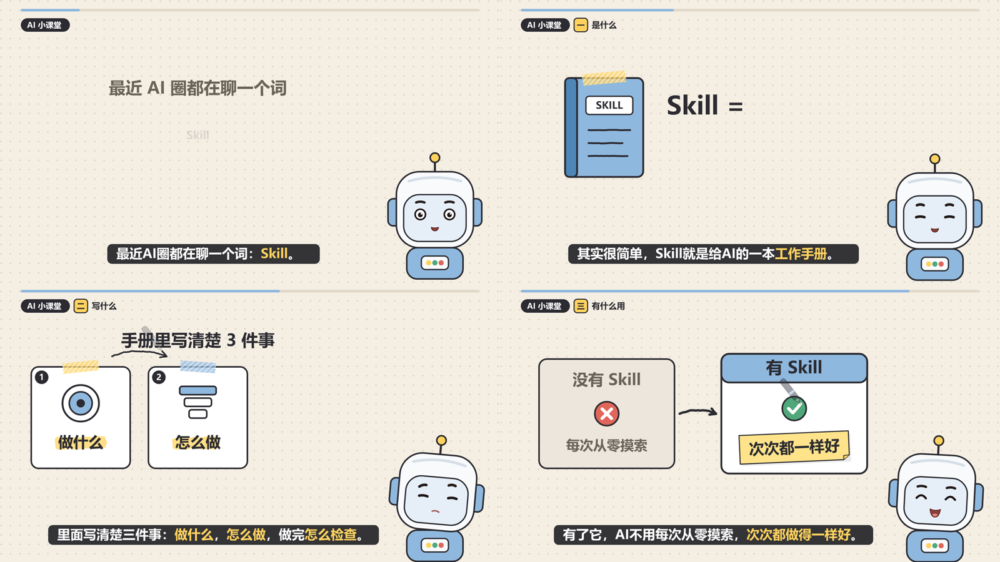

# AI 讲解视频流水线

写好稿子，双击一下，就能得到一条带**虚拟形象对口型**、手账风动画、关键词字幕的讲解视频。全程不用打开剪辑软件。

## 怎么用
- 下载后先看 `0-先看我-完整教程.html`（双击用浏览器打开）。
- 写给 AI agent 的操作手册在 `程序文件/SKILL.md`。

## 许可
免费使用、修改，可用于制作个人或商业视频；禁止打包出售。详见 [LICENSE](LICENSE)。
